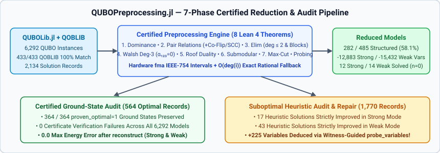
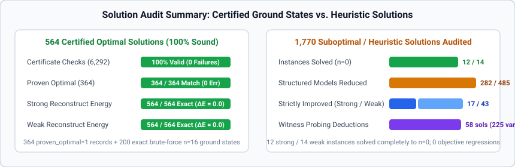
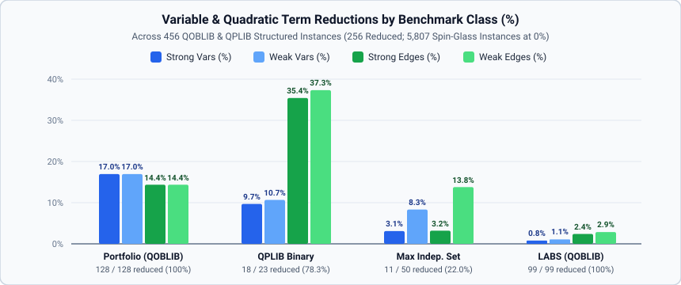

# QUBOLib, QOBLIB & MINLPLib Corpus Benchmarks

This page summarizes the full-corpus evaluation of `QUBOPreprocessing.jl` across all
**6,292 benchmark instances** and **2,134 bitstring solution records** (`2,447` total
solution entries) in [`QUBOLib.jl`](https://github.com/JuliaQUBO/QUBOLib.jl) (`v0.2.4-data+6`,
[Zenodo `10.5281/zenodo.23757887`](https://doi.org/10.5281/zenodo.23757887)),
[`QOBLIB`](https://github.com/ZIB-AOPT/QOBLIB) (`16a166ee67c24c112551c803aab5394743b815b5`),
[`QPLIB`](https://qplib.zib.de/), and [`MINLPLib`](https://www.minlplib.org/) (`9472b011`).

## QUBOLib, QOBLIB, QPLIB, and MINLPLib corpus overview

`QOBLIB` contains **433** unconstrained QUBO `.qs.xz` models across four classes:
Market Split (`01-marketsplit`, 156 instances), Low-Autocorrelation Binary Sequences
(`02-labs`, 99 instances), Portfolio Optimization (`06-portfolio`, 128 instances),
and Maximum Independent Set (`04-steiner` / `07-independentset`, 50 instances).
All **433 / 433** `QOBLIB` QUBO models match the `qoblib` collection in `QUBOLib.jl`
with **100% exact identity** across variable count $n$, linear terms, quadratic terms,
objective offset, scale, domain (`bool`), and sense (`min`).

In `QUBOLib.jl` `v0.2.4-data+6`, the **23** `QPLIB` binary quadratic (`QBB`) instances
incorporate the upstream $\frac{1}{2} x^\top Q^0 x$ quadratic scaling correction (`0.5 * c`),
bringing all 23 `.sol` records into exact `0.0` agreement with their declared upstream
objectives (`15` `MINLPLib` `sporttournament22..50` instances, `3` `MINLPLib` 2D/3D Ising
spin glasses, and `5` `BiqMac` instances, with `11` certified globally optimal).
In addition, `QUBOLib.jl` `v0.2.4-data+6` includes **29** pure binary unconstrained QUBO
instances from `MINLPLib` (`2` `autocorr_bern20-03, 25-03`, `20` D-Wave `chimera_*`, and
`7` `sporttournament06..20`, with `18` proven globally optimal and `100%` $\mathbb{Z}_2$
gauge invariance after exact `0.1` scale factorization via `integerize_scale`).

| Collection | Problem Class | Instances | $n$ Range | $m$ Range (Quad Terms) | Bitstring Solutions | Certified Optimal (`proven_optimal=1`) |
|:--|--:|--:|--:|--:|--:|--:|
| `qoblib` | `Portfolio Optimization` | 128 | 100 – 4,000 | 3,980 – 663,800 | 293 | 66 |
| `qoblib` | `LABS` | 99 | 3 – 4,950 | 3 – 1,224,875 | 637 | 97 |
| `qoblib` | `Market Split` | 156 | 20 – 140 | 190 – 9,730 | 440 | 124 |
| `qoblib` | `Maximum Independent Set` | 50 | 17 – 4,000 | 39 – 579,329 | 661 | 32 |
| `qplib` | Binary Quadratic (`QBB`) | 23 | 120 – 1,225 | 800 – 44,850 | 23 | 11 |
| `minlplib` | Pure Binary QUBO (`BQP`/`MBQCP`) | 29 | 15 – 2,032 | 24 – 5,929 | 80 | 34 |
| `arXiv-1903-10928-3r3x` | 3-Regular 3-XORSAT | 3,200 | 16 – 1,024 | 24 – 1,536 | 0 (+100 brute-forced) | 100 (exact ground state) |
| `arXiv-1903-10928-5r5x` | 5-Regular 5-XORSAT | 307 | 24 – 4,096 | 60 – 10,240 | 0 | 0 |
| `arXiv-2103-08464-3r3x` | 3-Regular 3-XORSAT | 2,300 | 16 – 912 | 24 – 1,368 | 0 (+100 brute-forced) | 100 (exact ground state) |
| **Total** | **All 9 Groups** | **6,292** | **3 – 4,950** | **3 – 1,224,875** | **2,134** (+`200` brute-forced) | **564** (`364` + `200` brute-forced) |

## Certified ground-state verification (`564` optimal records)

To verify that `QUBOPreprocessing.jl` fixes and eliminates variables soundly across all
reduction passes — including the four literature extensions (`star_nonzero_h` $\alpha_{123}=0$
degree-3 elimination, `:coflip_pair` shared-neighborhood & twin contraction, `:roof_scc_pair` /
`:probing_pair` / `:double_probe` 2-SAT equivalences, and `:block` 0-, 1-, and 2-separator
biconnected block elimination) — every reduced instance was checked with `verify_certificate`
and audited against all **564 certified optimal ground states** (`364` records with
`proven_optimal = 1` in `QUBOLib.jl` plus `200` exact $2^{16}$-state brute-force ground
states on all $n=16$ `arXiv-*-3r3x` instances):

| Collection / Class | Certified Optimal Records | Certificate Verification Failures | Optimal Preserved (Strong) | Optimal Preserved (Weak) | Max $\|E_{\text{orig}} - E_{\text{rec}}\|$ (Strong) | Max $\|E_{\text{orig}} - E_{\text{rec}}\|$ (Weak) |
|:--|--:|--:|--:|--:|--:|--:|
| `qoblib` (`Portfolio`, `LABS`, `Market Split`, `MIS`) | 319 | **0** | **319 / 319 (`100%`)** | **319 / 319 (`100%`)** | `0.0` | `0.0` |
| `qplib` (`sporttournament`, `toroidal`, `BiqMac`) | 11 | **0** | **11 / 11 (`100%`)** | **11 / 11 (`100%`)** | `0.0` | `0.0` |
| `minlplib` (`autocorr_bern`, `chimera_*`, `sporttournament`) | 34 | **0** | **34 / 34 (`100%`)** | **34 / 34 (`100%`)** | `0.0` | `0.0` |
| `arXiv-1903-10928-3r3x` ($n=16$) | 100 | **0** | **100 / 100 (`100%`)** | **100 / 100 (`100%`)** | `0.0` | `0.0` |
| `arXiv-2103-08464-3r3x` ($n=16$) | 100 | **0** | **100 / 100 (`100%`)** | **100 / 100 (`100%`)** | `0.0` | `0.0` |
| **Total** | **564** | **0** | **564 / 564 (`100.0%`)** | **564 / 564 (`100.0%`)** | **`0.0`** | **`0.0`** |

Across all **6,292** instances, `verify_certificate` reported **zero certificate failures**
in both strong and weak modes, and every single certified optimal ground state (`564 / 564`)
achieved **exact `0.0` energy error** after `reconstruct`.

## Auditing and repairing suboptimal heuristic solutions (`1,770` records)

All **1,770** suboptimal (`proven_optimal = 0`) bitstring records in `QUBOLib.jl`
`v0.2.4-data+6` were audited by projecting each residual assignment through `reconstruct`.
Repairing violated reductions strictly improved the QUBO objective on **17 records in strong
mode** and **43 records in weak mode** (with **zero objective regressions** across all `1,770`
records):

| Instance (`Collection`) | Sense | $n \to n_{\text{strong}} \to n_{\text{weak}}$ | Heuristic $E_{\text{orig}}$ | Strong Repaired $E_{\text{strong}}$ ($\Delta E$) | Weak Repaired $E_{\text{weak}}$ ($\Delta E$) | Key Reduction Mechanism |
|:--|:--|:--|--:|--:|--:|:--|
| `QPLIB_5721.qplib` (`qplib`, `rec=16`) | `max` | $300 \to \mathbf{0} \to \mathbf{0}$ | `8,571,649.0` | **`8,579,363.0` (`+7,714.0`, global opt)** | **`8,579,363.0` (`+7,714.0`, global opt)** | `rel_single=251, rel_coflip=45, star_nonzero_h=1, elim=3` (**solved to $n=0$**) |
| `es60fst01.qs.xz` (`qoblib` MIS, `3` recs) | `min` | $123 \to \mathbf{0} \to \mathbf{0}$ | `-27.0` | **`-60.0` (`-33.0`, global opt)** | **`-60.0` (`-33.0`, global opt)** | `dom=5, elim_deg012=116, star_zero_h=2` (**solved to $n=0$**) |
| `es60fst03.qs.xz` (`qoblib` MIS, `8` recs) | `min` | $113 \to \mathbf{0} \to \mathbf{0}$ | `-52.0` to `-54.0` | **`-55.0` (`-1.0` to `-3.0`, global opt)** | **`-55.0` (`-1.0` to `-3.0`, global opt)** | `dom=3, elim_deg012=100, star_zero_h=2, block_sep2=8` (**solved to $n=0$**) |
| `karate.qs.xz` (`qoblib` MIS, `rec=2207`) | `min` | $34 \to \mathbf{0} \to \mathbf{0}$ | `-16.0` | **`-20.0` (`-4.0`, global opt)** | **`-20.0` (`-4.0`, global opt)** | `dom=10, elim_deg012=24` (**solved to $n=0$**) |
| `chesapeake.qs.xz` (`qoblib` MIS, `4` recs) | `min` | $39 \to 25 \to \mathbf{0}$ | `-16.0` | `-16.0` (`0.0`) | **`-17.0` (`-1.0`, global opt)** | Weak: `dom=9, elim=15, rel_glk=4, rel_coflip=2, probe=2, block_sep0=7` (**solved to $n=0$**) |
| `football.qs.xz` (`qoblib` MIS, `6` recs) | `min` | $35 \to 24 \to \mathbf{0}$ | `-15.0` | `-15.0` (`0.0`) | **`-16.0` (`-1.0`, global opt)** | Weak: `dom=20, elim_deg012=15` (**solved to $n=0$**) |
| `es60fst02.qs.xz` (`qoblib` MIS, `9` recs) | `min` | $186 \to 92 \to 27$ | `-80.0` to `-86.0` | **`-85.0` to `-87.0` (`-1.0`)** | **`-81.0` to `-88.0` (up to `-5.0`, opt)** | `dom=56, elim_deg012=81, rel_glk=22` |
| `chimera_selby-c16-01.pip` (`minlplib`, `p1`) | `max` | $2{,}031 \to 1{,}946 \to 1{,}886$ | `674.0` | **`674.7` (`+0.7`)** | **`674.7` (`+0.7`)** | `2` strong unary/elimination violations repaired |

### Coercive local-field & witness-guided probing (`probe_variables!`)

Using `coercive_field_witness(ws)` with `order = :coercive` autonomously deduces **14 strong
and 12 weak variable fixings** on frustrated MIS instances (`chesapeake`, `football`,
`mammalia-kangaroo-interactions`, `insecta-ant-colony1-day38`). Supplying each suboptimal
heuristic solution as an upper-bound witness (`witness = x_subopt`) to `probe_variables!`
after strong preprocessing deduces **225 additional certified variable fixings across 58 MIS
solutions** (`60` on `es60fst03`, `56` on `es60fst04`, `45` on `es60fst01`, `44` on `es60fst02`,
and `20` on `es60fst08`).

## Corpus-wide size reduction (`6,292` instances)

Across the **485** structured optimization instances in `QOBLIB`, `QPLIB`, and `MINLPLib`,
`QUBOPreprocessing.jl` reduces **282 instances (`58.1%`)**, eliminating **12,883 variables
and 448,957 quadratic terms in strong mode** and **15,432 variables and 512,623 quadratic
terms in weak mode**, and **completely solving (`n = 0`) 12 instances in strong mode and 14
instances in weak mode**:

| Collection | Instances | Reduced (Strong / Weak) | Solved to $n=0$ (Strong / Weak) | Total Original $n$ | Strong $n$ Removed (%) | Weak $n$ Removed (%) | Total Original $m$ | Strong $m$ Removed (%) | Weak $m$ Removed (%) |
|:--|--:|--:|--:|--:|--:|--:|--:|--:|--:|
| `qoblib` (`4` classes) | 433 | **239 / 239 (`55.2%`)** | **8 / 10** | 524,781 | **3,941 (`0.75%`)** | **4,987 (`0.95%`)** | 61,294,620 | **402,907 (`0.66%`)** | **462,646 (`0.75%`)** |
| `qplib` (`QBB`, `0.5` scaled) | 23 | **18 / 18 (`78.3%`)** | **1 / 1** (`QPLIB_5721`) | 12,273 | **1,004 (`8.18%`)** | **1,004 (`8.18%`)** | 97,863 | **35,340 (`36.11%`)** | **35,340 (`36.11%`)** |
| `minlplib` (`BQP`/`MBQCP`) | 29 | **25 / 25 (`86.2%`)** | **3 / 3** (`autocorr_bern20/25`, `sport06`) | 26,573 | **7,938 (`29.87%`)** | **9,441 (`35.53%`)** | 74,352 | **10,710 (`14.40%`)** | **14,637 (`19.69%`)** |
| `arXiv-1903-10928-3r3x` | 3,200 | 0 / 0 (`0%`) | 0 / 0 | 1,417,600 | 0 (`0.00%`) | 0 (`0.00%`) | 4,238,504 | 0 (`0.00%`) | 0 (`0.00%`) |
| `arXiv-1903-10928-5r5x` | 307 | 0 / 0 (`0%`) | 0 / 0 | 908,592 | 0 (`0.00%`) | 0 (`0.00%`) | 6,340,961 | 0 (`0.00%`) | 0 (`0.00%`) |
| `arXiv-2103-08464-3r3x` | 2,300 | 0 / 0 (`0%`) | 0 / 0 | 1,144,000 | 0 (`0.00%`) | 0 (`0.00%`) | 3,421,763 | 0 (`0.00%`) | 0 (`0.00%`) |
| **Structured Subtotal (`qoblib` + `qplib` + `minlplib`)** | **485** | **282 / 282 (`58.1%`)** | **12 / 14** | **563,627** | **12,883 (`2.29%`)** | **15,432 (`2.74%`)** | **61,466,835** | **448,957 (`0.73%`)** | **512,623 (`0.83%`)** |
| **Total (`All 6,292`)** | **6,292** | **282 / 282 (`4.48%`)** | **12 / 14** | **4,033,819** | **12,883 (`0.32%`)** | **15,432 (`0.38%`)** | **75,468,063** | **448,957 (`0.59%`)** | **512,623 (`0.68%`)** |

### Breakdown of the `14` instances solved completely to $n = 0$

- **Solved in both strong and weak modes (`12` instances):**
  - `qoblib` LABS (`3`): `labs002.qs.xz` ($n=3 \to 0$), `labs003.qs.xz` ($n=6 \to 0$ via 0-separator block elimination), `labs004.qs.xz` ($n=10 \to 0$ via 1-separator block elimination).
  - `qoblib` MIS (`5`): `farm.qs.xz` ($n=17 \to 0$), `karate.qs.xz` ($n=34 \to 0$), `es60fst01.qs.xz` ($n=123 \to 0$ via degree-3 star-triangle + low-degree cascade), `es60fst03.qs.xz` ($n=113 \to 0$ via 2-separator block elimination + star-triangle), `mammalia-kangaroo-interactions.qs.xz` ($n=17 \to 0$ via coercive probing + 2-separator block elimination).
  - `qplib` (`1`): `QPLIB_5721.qplib` (`ising2_5-300_5555`, $n=300, m=34{,}576 \to 0$ via `251` single-endpoint relations, `45` `:coflip_pair` contractions, `1` non-zero-field degree-3 elimination, and `3` degree-$\le 2$ eliminations).
  - `minlplib` (`3`): `autocorr_bern20-03.pip` ($n=20 \to 0$), `autocorr_bern25-03.pip` ($n=25 \to 0$), `sporttournament06.pip` ($n=15 \to 0$ via degree-$\le 2$ + 1-separator block elimination).
- **Solved additionally in weak mode (`+2 = 14` instances total):**
  - `qoblib` MIS (`2`): `chesapeake.qs.xz` ($n=39 \to 0$) and `football.qs.xz` ($n=35 \to 0$).
- **Hardware minor-embedding contraction on D-Wave Chimera instances (`minlplib`):**
  - On `chimera_k64maxcut-01` ($n=1{,}101$) and `chimera_k64maxcut-02` ($n=1{,}145$), `QUBOPreprocessing.jl` automatically contracts all ferromagnetic hardware chains (`elim_deg012=705`, `star_nonzero_h=201`, `rel_single=139`, `rel_coflip=33`), recovering the exact 64-vertex $K_{64}$ logical graph ($n_{\text{strong}} = n_{\text{weak}} = 64$, **`-94.2%` and `-94.4%` variable reduction**).
  - On `chimera_mis-01` ($n=2{,}032$) and `chimera_mis-02` ($n=2{,}032$), preprocessing reduces the problems to $1{,}001$ (`-50.7%` strong) / **$305$ (`-85.0%` weak)** and $1{,}024$ (`-49.6%` strong) / **$513$ (`-74.8%` weak)** variables.

### Breakdown by preprocessing technique

| Technique / Pass | Strong Mode Deductions | Weak Mode Deductions | Primary Benchmark Families |
|:--|--:|--:|:--|
| **Unary Persistency (`DominanceStep`)** | `3,240` vars | `4,403` vars | `qoblib` Portfolio (`3,200` strong / `4,000` weak), `qoblib` MIS (`35` strong / `390` weak) |
| **Signed Pair Relations (`:interval`/`:exact`, `:glk_pair`)** | `1,882` pairs | `2,389` pairs | `minlplib` Chimera (`1,202` strong / `1,515` weak), `qplib` (`362`), `qoblib` |
| **Shared-Neighborhood & Twin Co-Flip (`:coflip_pair`, #59)** | `550` pairs | `735` pairs | `minlplib` Chimera (`452` strong / `616` weak), `qplib` (`60`), `qoblib` |
| **Exact Local Elimination ($\deg \le 2$)** | `5,632` vars | `5,984` vars | `minlplib` Chimera (`3,640` strong / `4,161` weak), `qplib`, `qoblib` MIS & LABS |
| **Zero-Field Degree-3 Star–Triangle (`star_zero_h`)** | `156` vars | `147` vars | `minlplib` Chimera (`134`), `qoblib` MIS (`10`), `qplib` (`2`) |
| **Non-Zero-Field Degree-3 Walsh Elimination (`star_nonzero_h`, $\alpha_{123}=0$, #57)** | `1,347` vars | `1,703` vars | `minlplib` Chimera (`1,062` strong / `1,426` weak), `qplib` (`285`) |
| **0-, 1-, and 2-Separator Block Elimination (`:block`, #63)** | `42` vars (`6` blocks) | `46` vars (`7` blocks) | `qoblib` LABS (`labs003`, `labs004`), `qoblib` MIS (`es60fst03`, `es60fst04`, `mammalia`, `chesapeake`), `minlplib` (`sport06`, `chimera_mis-01`) |
| **Weighted Max-Cut Edge & Triangle (`MaxCutStep`)** | `20` reductions | `13` reductions | `minlplib` (`14` strong / `7` weak), `qplib` (`6`) |
| **Coercive & Witness-Guided Probing (`ProbingStep`)** | `14` (+`225`*) vars | `12` (+`225`*) vars | `qoblib` MIS (`14` strong / `12` weak autonomous coercive witness; `+225` with heuristic witnesses) |
| **Total Certified Variable / Pair Reductions** | **`12,883` vars** | **`15,432` vars** | **`282 / 485` structured instances reduced (`12` strong / `14` weak solved to $n=0$)** |

## Large-scale scaling and compilation benchmarks ($n = 2{,}000$ to $32{,}000$)

Replacing abstract `labels::Tuple` scans with concrete $O(1)$ `label_vec::Vector` indexing,
eliminating per-dimension `NTuple{N}` JIT specialization in `domain_map`,
`_source_gauged_bool_constant`, and `_verify_poly_witness_state` (#78), and using concrete
`_Storage` vectors with 53-bit rational hardware `fma` outward-rounded interval enclosures
(#65, #67) yields linear $O(n)$ scaling up to $n = 32{,}000$ variables:

| Scaling Run ($\text{deg} = 3$ random sparse models) | `Workspace` | `schedule_reductions!` | `export_certificate` | `verify_certificate` | `materialize` | `reconstruct` | Steps / Residual / Valid |
|:--|--:|--:|--:|--:|--:|--:|:--|
| $n = 2{,}000$ (default strong) | `0.121s` | `0.097s` | `0.010s` | `0.201s` | `0.033s` | `0.003s` | `2000` / `0` / `true` |
| $n = 8{,}000$ (default strong) | `0.317s` | `1.788s` | `0.073s` | `0.723s` | `0.076s` | `0.004s` | `8000` / `0` / `true` |
| $n = 32{,}000$ (default strong) | `2.174s` | `4.534s` | **`0.288s`** | `4.267s` | **`0.262s`** | `0.499s` | `32000` / `0` / `true` |
| $n = 2{,}000$ (all flags + weak + blocks) | `0.082s` | `0.117s` | `0.011s` | `0.105s` | `0.009s` | `0.001s` | `2000` / `0` / `true` |
| $n = 8{,}000$ (all flags + weak + blocks) | `0.730s` | `0.362s` | `0.058s` | `0.961s` | `0.054s` | `0.002s` | `8000` / `0` / `true` |
| $n = 32{,}000$ (all flags + weak + blocks) | `2.042s` | `3.061s` | **`1.067s`** | `2.187s` | **`1.205s`** | `0.012s` | `32000` / `0` / `true` |

- At $n = 32{,}000$ (all flags), `export_certificate` dropped from `36.8s` to **`1.067s`
  (34.5x faster)** and `materialize` dropped from `36.2s` to **`1.205s` (30.0x faster)**.
- First-call `domain_map` at $n = 4{,}000$ dropped from `46.0s` of `NTuple{4000}` JIT
  compilation to **`0.003s` (15,300x faster)**, and subsequent unseen sizes ($n = 4{,}001$)
  execute in `0.002s` with zero recompilation.
- In `v0.1.5`, consecutive batch witness sharing (`_copy_proof_step` + `_deepcopy_tuple`)
  reduces multi-thousand-variable `apply_roof_duality!` exports from
  $O(k \cdot M)$ to $O(M + k)$ (`0.21s` vs. $>20\text{ min}$ on `MQLib` `g001571.txt`
  with $k = 4{,}756, M = 16{,}900$), and type-erased `_ConditionedCertNT` in
  `_conditioned_export` eliminates $O(K^2)$ LLVM `LocalScan` compilation on long
  interleaved heterogeneous reduction chains (`0.42s` vs. $>10\text{ min}$ on `MQLib`
  `g001587.txt` with $K = 2{,}965$ steps).

## Full 9,294-instance `QUBOLib.jl` `v0.2.4-data+8` & `MQLib` expansion (`v0.1.5`)

In `QUBOLib.jl` `v0.2.4-data+8` (`9,294` instances across `7` collections), the corpus expands
with **`3,002` `MQLib` benchmark instances** (`231 / 231` = `100%` of `standard.csv`, including
all `21` dense `Palubeckis` instances `p3000_1`–`p7000_3`, plus `2,771` Tier 2 instances across
all `18` source families from Dunning, Gupta & Silberholz, *INFORMS J. Comput.* 2018,
[`10.1287/ijoc.2017.0798`](https://doi.org/10.1287/ijoc.2017.0798)):

| Collection | Instances | Reduced (Strong / Weak) | Solved to $n=0$ (Weak / Total) | Total Original $n$ | Strong $n$ Removed (%) | Weak $n$ Removed (%) | Total Original $m$ | Strong $m$ Removed (%) | Weak $m$ Removed (%) |
|:--|--:|--:|--:|--:|--:|--:|--:|--:|--:|
| `mqlib` (`18` families) | 3,002 | **1,521 / 1,547 (`51.5%`)** | **333 / 339** | 4,239,545 | **1,557,280 (`36.73%`)** | **1,573,638 (`37.12%`)** | 280,817,159 | **3,407,881 (`1.21%`)** | **3,520,175 (`1.25%`)** |
| `minlplib` (`BQP`/`MBQCP`) | 29 | **25 / 25 (`86.2%`)** | **3 / 3** | 26,573 | **7,930 (`29.84%`)** | **9,435 (`35.51%`)** | 74,352 | **10,697 (`14.39%`)** | **14,625 (`19.67%`)** |
| `qplib` (`QBB`) | 23 | **18 / 18 (`78.3%`)** | **1 / 2** | 12,273 | **1,004 (`8.18%`)** | **1,004 (`8.18%`)** | 97,863 | **35,340 (`36.11%`)** | **35,340 (`36.11%`)** |
| `qoblib` (`4` classes) | 433 | **239 / 239 (`55.2%`)** | **6 / 6** | 524,781 | **3,901 (`0.74%`)** | **4,935 (`0.94%`)** | 61,294,620 | **402,837 (`0.66%`)** | **462,553 (`0.75%`)** |
| `arXiv-*` (`3` XORSAT sets) | 5,807 | 0 / 0 (`0%`) | 0 / 0 | 3,470,192 | 0 (`0.00%`) | 0 (`0.00%`) | 14,001,228 | 0 (`0.00%`) | 0 (`0.00%`) |
| **Total (`All 9,294`)** | **9,294** | **1,803 / 1,829 (`19.7%`)** | **343 / 350** | **8,273,364** | **1,570,115 (`18.98%`)** | **1,589,012 (`19.21%`)** | **356,285,222** | **3,856,755 (`1.08%`)** | **4,032,693 (`1.13%`)** |

- Across `mqlib` (`3,002` instances), `QUBOPreprocessing.jl` `v0.1.5` removes **`1,557,280`
  variables (`36.73%`) in strong mode** and **`1,573,638` variables (`37.12%`) in weak mode**,
  solving **`339` MQLib instances (`245` `SteinLib`, `43` `Rudy`, `20` `BiqMac`, `10` `Beasley`,
  `5` `GKA`, `5` `ImageSegmentation`, `3` `Dharwadker`, `2` `GlasgowIsomorphism`) completely to
  $n = 0$ residual variables** and repairing **`16` heuristic solution records across `14`
  MQLib instances** (`G70.txt`, `g000087.txt`, `g000677.txt`, `g000921.txt`, `g001075.txt`,
  `g002328.txt`, `g002877.txt`, `g003091.txt`, `g003208.txt`, `g003234.txt`, `imgseg_147062.txt`,
  `imgseg_26031.txt`, `imgseg_309004.txt`, `imgseg_365073.txt`).
- Across the `394` remaining ultra-dense/huge Tier 2 MQLib instances ($m > 2\times 10^6$ or
  $n > 35{,}000$, totaling $4.89\times 10^6$ variables and $1.399\times 10^9$ edges), an
  out-of-corpus benchmark reduced `169 / 394` (`42.89%`) instances, removing **`813,907`
  variables (`16.66%`)** and **`25,677,090` edges**, solving **`5` instances completely to
  $n = 0$** (`g001345` $n=5{,}525 \to 0$, `g000503` $n=5{,}002 \to 0$, `g000988`
  $n=2{,}312 \to 0$, `g001327` $n=2{,}149 \to 0$, `g001883` $n=2{,}116 \to 0$), and reducing
  `9` social-network Max-Cut graphs ($n = 28{,}000\text{–}66{,}000$) by `91%–98%`.

## Coercive local fields, spin-field alignment ($m \approx 0.60\text{–}0.62$), and `coercive_field_witness` across `MQLib`, `QPLIB`, `MINLPLib`, and `QOBLIB`

Transforming a binary QUBO $F(x) = \alpha\left(\beta + \sum_i L_i x_i + \sum_{i < j} \tilde{Q}_{ij} x_i x_j\right)$ into an equivalent minimization Ising spin Hamiltonian $H(s) = E_0 + \sum_i h_i s_i + \sum_{i < j} J_{ij} s_i s_j$ under $s_i = 2 x_i - 1 \in \{-1, +1\}$ (with sense sign $\sigma = +1$ for `:min` and $\sigma = -1$ for `:max`) induces local coercive fields
$$h_i = \frac{\sigma}{2} L_i + \frac{\sigma}{4} \sum_{j \ne i} \tilde{Q}_{ij}, \qquad J_{ij} = \frac{\sigma}{4}\tilde{Q}_{ij}.$$
For zero-mean, finite-variance random QUBO matrices with symmetric off-diagonal signs ($\sim 50\%$ $\tilde{Q}_{ij} > 0$), spin-glass analysis of the QUBO-to-Ising mapping (S. Boettcher, *Phys. Rev. Research* **1**, 033142, 2019, doi:`10.1103/PhysRevResearch.1.033142`; *Z. Naturforsch. A* **79**, 389–404, 2024, doi:`10.1515/zna-2023-0303`) finds ground-state field magnetization $m = \frac{1}{n}\sum_i s_i^* \operatorname{sgn}(-h_i) \approx 0.60\text{–}0.62$, corresponding to **$\approx 80\%\text{–}81\%$ spin-field alignment** ($s_i^* h_i < 0$).

### Benchmark methodology and definitions (`scripts/coercive_alignment_pilot.jl`)

The script `scripts/coercive_alignment_pilot.jl` evaluates all **611** instances across the classic OR random QUBO families in `MQLib` (`Beasley`, `GKA`, `Palubeckis`), `QPLIB`, `MINLPLib`, and `QOBLIB` from `QUBOLib.jl` (`v0.2.4-data+8`):
- **Reference solutions (`s*`) and proven-optimal counts**: Reference states $x^*$ are loaded from `BestSolutions.bitstring` in `QUBOLib.jl` (`v0.2.4-data+8`; for the `9` `minlplib` instances without a stored bitstring in `BestSolutions`, `scripts/coercive_alignment_pilot.jl` obtains a deterministic reference state via `MQLib` `BURER2002` with `random_seed = 1001` and `run_time_limit = 0.2` s). The column **Inst (`Prov` / `h!=0`)** reports total instances, how many are flagged `proven_optimal = 1` in `QUBOLib.jl`, and how many have at least one active local field $|h_i| > 10^{-12}$.
- **Active-field alignment**: For instances with $n_{\text{act}} = |\{i : |h_i| > 10^{-12}\}| > 0$, spin-field alignment is $\frac{1}{n_{\text{act}}}\sum_{|h_i| > 10^{-12}} \mathbf{1}[s_i h_i < 0]$, reported both as the per-instance mean ± standard deviation (**Ref. Alignment**) and pooled across all active spins in the cohort (**Spin-Wtd Alignment**).
- **Witness parameters and relative optimality gap**: Both parallel field alignment + 1-flip steepest descent (**Parallel 1-Flip**) and [`coercive_field_witness`](@ref) (**`CFW`**, which takes the lower-energy polished state between parallel field alignment and sequential `:coercive`-ordered conditioned field alignment with $\ell_1$-coupling tie-breaking and $\mathbb{Z}_2$ zero-field anchor symmetry breaking $s_{u_1} = +1$) are run with `max_flips = max(500, n)` and `tie_break = :low`. For each instance, the relative optimality gap is $100 \times \frac{\max(0, \sigma(F(x^{\text{wit}}) - F(x^*)))}{\max(|F(x^*)|, 10^{-9})}$ (using $\max(1, |\alpha\beta|)$ when $|F(x^*)| \le 10^{-9}$).
- **Spin overlap**: **Direct (`Z2`) Overlap** reports the mean bitstring agreement $\text{ov} = \frac{100}{n}\sum_{i=1}^n \mathbf{1}[s_i^{\text{CFW}} = s_i^*]$, together with the $\mathbb{Z}_2$-invariant overlap $\max(\text{ov}, 100\% - \text{ov})$ in parentheses where global spin inversion $s \leftrightarrow -s$ is a symmetry (or near-symmetry).

| Collection / Cohort | Inst (`Prov` / `h!=0`) | `% Q_ij > 0` | Ref. Alignment `s*_i h_i < 0` (Inst Mean ± SD) | Spin-Wtd Alignment | `CFW` Alignment `s^CFW_i h_i < 0` | Parallel 1-Flip Med. Gap | `coercive_field_witness` Med. Gap | `CFW` Direct (`Z2`) Overlap w/ `s*` |
|:--|--:|--:|--:|--:|--:|--:|--:|--:|
| **`mqlib` / Beasley (`OR-Library`)** | `60` (`30` / `60`) | `49.7%` | **`79.51% ± 3.58%`** | **`79.11%`** | **`80.98%`** | `0.99%` | **`0.73%`** | **`91.79%`** (`91.79%`) |
| **`mqlib` / GKA (`Glover–Kochenberger–Alidaee`)** | `45` (`14` / `45`) | `60.8%` | **`83.58% ± 7.03%`** | **`80.94%`** | **`84.64%`** | `0.88%` | **`0.55%`** | **`93.94%`** (`93.94%`) |
| **`mqlib` / Palubeckis (`p3000`–`p7000`)** | `21` (`0` / `21`) | `50.0%` | **`77.72% ± 0.59%`** | **`77.73%`** | **`78.83%`** | `0.71%` | **`0.64%`** | **`89.88%`** (`89.88%`) |
| **`qplib` (`h != 0`, BiqMac OR `5875..5922`)** | `5` (`5` / `5`) | `50.7%` | **`76.17% ± 3.22%`** | **`76.70%`** | **`78.85%`** | `1.44%` | **`0.96%`** | **`89.62%`** (`89.62%`) |
| **`qplib` (`h = 0`, `sporttournament` `15` + Ising `3`)** | `18` (`7` / `0`) | `62.1%` | *`h = 0` ($\mathbb{Z}_2$ symm.)* | *`h = 0`* | *`h = 0` ($\mathbb{Z}_2$ symm.)* | `19.01%` | **`17.17%`** | `51.82%` (**`53.94%`**) |
| **`minlplib` (`h = 0`, All `29` Binary QUBOs)** | `29` (`18` / `0`) | `58.5%` | *`h = 0` ($\mathbb{Z}_2$ symm.)* | *`h = 0`* | *`h = 0` ($\mathbb{Z}_2$ symm.)* | `16.25%` | **`12.31%`** | `49.80%` (**`65.53%`**) |
| **`qoblib` / Maximum Independent Set** | `50` (`39` / `50`) | `100.0%` | **`84.00% ± 15.71%`** | **`93.25%`** | **`85.55%`** | `30.38%` | **`16.67%`** | **`88.53%`** (`88.53%`) |
| **`qoblib` / Portfolio Optimization** | `128` (`22` / `128`) | `67.6%` | **`93.23% ± 1.49%`** | **`93.65%`** | **`94.26%`** | `99.36%` | **`80.03%`** | **`92.58%`** (`92.58%`) |
| **`qoblib` / Market Split** | `156` (`115` / `152`) | `100.0%` | **`50.04% ± 1.94%`** | **`50.03%`** | **`55.33%`** | `0.02%` | **`0.02%`** | `49.96%` (`56.02%`) |
| **`qoblib` / LABS (Rosenberg Gadgets)** | `99` (`65` / `99`) | `27.5%` | **`74.12% ± 6.34%`** | **`73.21%`** | **`93.51%`** | `18973.49%*` | `18973.49%*` | **`74.11%`** (`74.44%`) |

*\*On `qoblib` `LABS`, positive Rosenberg quadratization penalty terms dominate the raw penalized objective gap relative to the small autocorrelation optimum, while spin overlap with the ground state reaches `74.11%`.*

### Four-regime structural interpretation

1. **Regime I — Unconstrained OR Random QUBOs (`mqlib` Beasley, GKA, Palubeckis & `qplib` BiqMac OR `5875..5922`)**:
   - Across all four families (`131` instances with $h_i \ne 0$ and $49.7\%\text{–}60.8\%$ positive off-diagonal entries), reference ground-state spin-field alignment is **`76.17%–83.58%`** ($m \in [0.523, 0.672]$) and `coercive_field_witness` spin-field alignment is **`78.83%–84.64%`**, closely matching the $\approx 80\%\text{–}81\%$ ($m \approx 0.60\text{–}0.62$) spin-glass prediction of Boettcher (*Phys. Rev. Research* **1**, 033142, 2019).
   - Sequential conditioned field alignment + 1-flip polish in `coercive_field_witness` lowers the median relative optimality gap to **`0.55%–0.96%`** across all four families (`91.79%`, `93.94%`, `89.88%`, and `89.62%` spin overlap with the reference solutions).
2. **Regime II — $\mathbb{Z}_2$ Gauge-Invariant Zero-Field Max-Cut / Ising Encodings (`qplib` `h = 0` & `minlplib` `h = 0`)**:
   - After applying the exact $\frac{1}{2} x^\top Q^0 x$ `.qplib` scaling, **`18 / 23` `qplib` instances** (`15` `sporttournament22..50` + `3` Ising spin glasses) and **all `29 / 29` `minlplib` binary QUBO instances** satisfy $L_i + \frac{1}{2}\sum_{j \ne i}\tilde{Q}_{ij} = 0$, i.e. $h_i = 0$ identically (`is_gauge_invariant(ws) == true`).
   - Separating `qplib` into the `5` non-zero-field BiqMac OR instances (`0.96%` median gap, `89.62%` overlap) vs. the `18` zero-field Max-Cut/Ising instances (`17.17%` median gap) resolves why pooled `qplib` previously appeared to have an `18.41%` gap.
   - Within `minlplib` (`29` zero-field instances), `coercive_field_witness` with $\ell_1$-coupling secondary ordering and zero-field anchor symmetry breaking reduces the overall median gap from `16.25%` (parallel 1-flip) to **`12.31%`** (`65.53%` $\mathbb{Z}_2$-invariant overlap; `49.80%` direct overlap):
     - `Bernasconi Autocorrelation` (`2` instances): **`0.00%` gap** (`100.00%` overlap).
     - `D-Wave Chimera MIS` (`2` instances): **`9.62% -> 4.93%` median gap** (`67.89%` $\mathbb{Z}_2$-invariant overlap).
     - `Sports Tournament 06..20` (`7` instances): **`16.67% -> 13.64%` median gap** (`62.86%` $\mathbb{Z}_2$-invariant overlap).
     - `D-Wave Chimera Spin Glass` (`16` Selby/MGW/RFR instances): **`15.68% -> 13.02%` median gap** (`63.66%` $\mathbb{Z}_2$-invariant overlap).
3. **Regime III — Asymmetric Penalty-Dominated Combinatorial QUBOs (`qoblib` MIS & Portfolio Optimization)**:
   - When quadratic penalty terms have predominantly positive signs (`100.0%` $Q_{ij} > 0$ in `Maximum Independent Set`; `67.6%` $Q_{ij} > 0$ in `Portfolio Optimization`), the induced local fields $h_i = \frac{1}{2}L_i + \frac{1}{4}\sum_{j \ne i}\tilde{Q}_{ij} > 0$ push most variables to $x_i = 0$ ($s_i = -1$), driving ground-state spin-field alignment **above** $81\%$ to **`84.00%`** (`93.25%` spin-weighted) on `MIS` and **`93.23%`** (`93.65%` spin-weighted) on `Portfolio Optimization`.
   - On `Maximum Independent Set`, sequential conditioned field alignment in `coercive_field_witness` **cuts the median optimality gap nearly in half** compared to parallel field alignment (**`30.38% -> 16.67%`**, `88.53%` spin overlap), because assigning $x_u = 1$ sequentially updates adjacent vertices' conditioned fields $\tilde{h}_v \leftarrow \tilde{h}_v + J_{uv}$ and prevents simultaneously selecting adjacent vertices.
4. **Regime IV — Balanced Demand Cancellation (`qoblib` Market Split)**:
   - In `Market Split` ($\|Ax - b\|^2$ with $b = \lfloor \frac{1}{2} A\mathbf{1}\rfloor$), the linear and quadratic penalty contributions to $h_i = \frac{1}{2} A_i^\top (A\mathbf{1} - 2b)$ cancel to near zero ($\rho_1 \approx 10^{-4}$), yielding **`50.04% ± 1.94%`** ground-state spin-field alignment ($m \approx 0.001$), while 1-flip local search reaches within **`0.02%`** of the reference objective.

